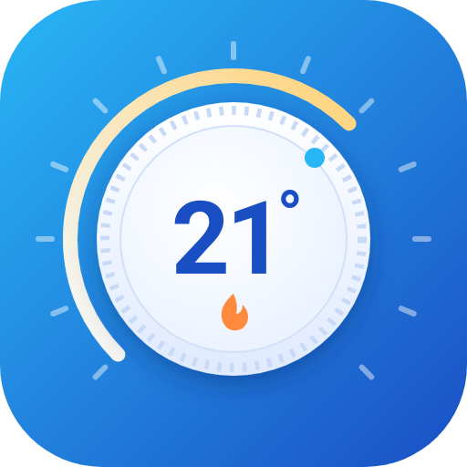
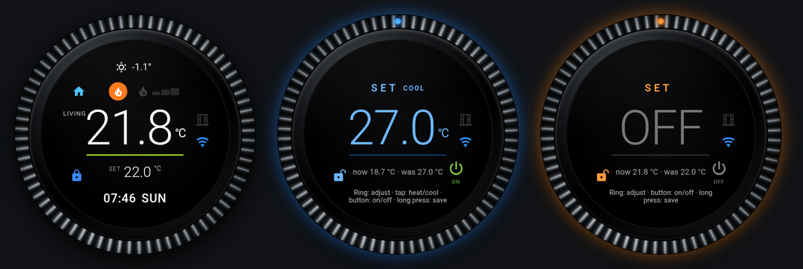

#  HC Dial Card

[English](README.md) · **Magyar**

[](https://hacs.xyz/docs/faq/custom_repositories)
[](https://github.com/Gyuszko55/hc-dial-card/actions/workflows/validate.yml)

Kerek, fali termosztát kinézetű kártya Home Assistanthoz. **Bármely `climate` entitással** működik, egy célértékkel vagy fűtés/hűtés tartománnyal. Ha kéred, **követi, melyik helyiségben van a telefonod**, és mindig annak a helyiségnek a termosztátját mutatja.



## Tudnivalók

- **Biztonságos állítás.** Tartsd nyomva a kijelzőt: SET módba lép (a tetején a termosztát neve és területe, hogy lásd, melyiket állítod). Forgasd a recés gyűrűt (vagy használd az egérgörgőt, a nyilakat), majd újabb hosszú nyomással rögzítsd. Forgatás közben semmit nem küld; 15 másodperc érintés nélkül mentés nélkül kilép a SET módból.
- **Bármely climate entitás.** Egy cél (`temperature`) vagy tartomány (`target_temp_low` / `target_temp_high`): SET módban rövid koppintás vált a fűtési és a hűtési cél között. A kártya a `supported_features` alapján csak azt kínálja, amit a termosztát tud.
- **Be / ki.** SET módban bekapcsoló gomb, ugyanazzal a hosszú nyomással rögzül. Ahol támogatott, `climate.turn_on` / `climate.turn_off` hívással dolgozik, így a termosztát a saját korábbi módjába tér vissza.
- **Minden egy pillantásra.** Benti hőfok, cél, időjárás, kinti hőfok, páratartalom, üzemmód, mit csinál éppen (fűt, hűt, előfűt, leolvaszt, szárít, ventilál), preset ikon (takarék = levél, alvás = ágy …), nyitott ablak, elérhetőség.
- **Helyiségkövetés (opcionális).** Helyiség-szenzorral (Bermuda, ESPresense, Wi-Fi BSSID …) arra a termosztátra vált, amelyik helyiségben vagy. Ha egy helyiségben több termosztát van (pl. TRV és klíma), a bekapcsolt jelenik meg.
- **Termosztátok hozzáadása kód nélkül.** A termosztát ikonra koppintva (csak adminnak) a kártya felsorolja a felismert termosztátokat és TRV-ket; koppintás kijelöl, hosszú nyomás hozzáadja vagy leveszi. Az új termosztát a saját HA területe alá kerül a `rooms`-ba (TRV `trv: true`-val), a kártya maga menti a vezérlőpultba (YAML módú vezérlőpulton nem lehet). Több termosztát között dupla koppintással lapozol; a gyűrűn kívüli koppintás azonnal bezárja a nyitott menüt, és visszahozza a fő termosztátot.
- **Saját betűtípus.** A kártya a HA saját Roboto betűjét használja, saját néven, így a telefon lecserélt rendszerbetűje (Samsung, Xiaomi …) nem írja felül; a telefon nagyított betűméretét a kártya méri és kiegyenlíti, így a kép nem esik szét.
- **Preset-menü.** A preset ikonra koppintva presetet választhatsz (komfort, eco, távol …). HC Thermostattal minden sor azt is mutatja, meddig tart („22:00-ig”, „hazaérkezésig”).
- **Szabályozás fajtája.** A kártya bal felső részén látszik, mi szabályoz; a preset ikon a hőfok előtt van.

  | Termosztát | Kijelzés |
  |---|---|
  | HC Thermostat | TPI, PID, KÜLSŐ (külső termosztát) |
  | Generic thermostat (be/ki, hiszterézissel) | HIST |
  | Smart Thermostat | PID, vagy HIST, ha a PID ki van kapcsolva |
  | SAT (Smart Autotune Thermostat) | SAT·PWM (be/ki kazán), SAT·OT (moduláló, OpenThermen) |
  | Better Thermostat | BT, BT·PID, BT·MPC (a kalibrációja szerint) |
  | Versatile Thermostat | TPI, AUTO-TPI (tanuló), VT·REG (klíma fölött önszabályozással), VT |
  | OpenTherm Gateway, ebusd | OT, eBUS |
- **Készülékenkénti választás.** A külső gyűrű hosszú nyomására kiválaszthatod, melyik jeladót kövesse *ez* a készülék (vagy egyiket se). A választást az adott készülék böngészője tárolja.
- **°C / °F** a Home Assistant beállításából, a számformátum a nyelvi beállításból. Szövegek magyarul, angolul és németül.
- **Grafikus szerkesztő**, billentyűzetes kezelés, felolvasható feliratok.

## Telepítés

### HACS (ajánlott)

1. Nyisd meg a HACS-ot, és keress rá: **HC Dial Card**.
2. Töltsd le, és töltsd újra a böngészőt.

### HACS (egyedi tároló)

Ha a keresés nem találja (amíg a HACS alaplistájába való felvételre vár, vagy régebbi HACS-nál):

1. HACS → ⋮ → *Custom repositories* → `https://github.com/Gyuszko55/hc-dial-card`, típus: **Dashboard**.
2. Telepítsd a **HC Dial Card**-ot, és töltsd újra a böngészőt.

### Kézzel

Másold a `hc-dial-card.js` fájlt a `config/www/` mappába, és vedd fel vezérlőpult-erőforrásnak:

```yaml
url: /local/hc-dial-card.js
type: module
```

## Használat

### Legegyszerűbb

```yaml
type: custom:hc-dial-card
entity: climate.nappali
```

### Kiegészítőkkel

```yaml
type: custom:hc-dial-card
entity: climate.nappali
label: area            # a termosztát területének neve (max 6 karakter); vagy bármilyen szöveg, pl. "SZOBA"
weather: weather.otthon
outdoor: sensor.kinti_homerseklet
humidity: sensor.nappali_paratartalom
heating: binary_sensor.kazan_eg          # opcionális: a valódi égés jelzője a lánghoz
power: sensor.klima_teljesitmeny         # opcionális: felvett teljesítmény (W); a 3 lépcső a power_max harmadai
power_max: 1800                          # opcionális, alap 1800 W (power_idle: 40 W alatt áll)
                                         # teljesítmény nélkül a termosztát igénye (HC Thermostat, Versatile
                                         # power_percent, Smart Thermostat control_output): ≤10 % 1 lépcső,
                                         # ≤30 % 2, fölötte 3; különben fűtéskor mindhárom
heat_type: auto                          # opcionális: a fűtés ikonja – gas_boiler (piros felszálló hő; égéskor láng), floor,
                                         # radiator, heat_pump, air_conditioner (nap-hópehely, fűtés narancs / hűtés kék; működéskor ventilátor), electric,
                                         # stove, district, solar, flame; auto = a termosztát heat_type
                                         # attribútuma (HC Thermostat), különben klíma, ha tud hűteni
window: [binary_sensor.nappali_ablak]
```

### Helyiségkövetés Bermudával

```yaml
type: custom:hc-dial-card
entity: climate.haz                      # fő termosztát: minden más helyiségben és távollétben ez látszik
label: area
follow_app_only: true                    # csak a Companion appban kövessen
follow:
  Anna: sensor.anna_telefon_helyiseg     # HA felhasználónév (vagy azonosító) → helyiség-szenzor
  Péter: sensor.peter_telefon_helyiseg
rooms:
  Terasz: climate.terasz_klima
  Hálószoba:                             # több termosztát: a bekapcsolt látszik
    - entity: climate.haloszoba_trv
      trv: true                          # a TRV akkor számít bekapcsoltnak, ha a fő termosztát be van kapcsolva
    - climate.haloszoba_klima
```

### ESPresense vagy Wi-Fi

Bármilyen értéket helyiséghez rendelhetsz a `room_map`-pel:

```yaml
follow: sensor.anna_telefon_espresense   # állapota: nappali
room_map:
  nappali: Nappali
  "aa:bb:cc:dd:ee:ff": Terasz            # Wi-Fi BSSID a Companion appból
rooms:
  Terasz: climate.terasz_klima
```

A helyiségneveket a HA terület nevével vagy azonosítójával veti össze, kis- és nagybetűtől, ékezettől függetlenül.

### A telefonok beállítása (Bermuda)

Kell hozzá a [Bermuda](https://github.com/agittins/bermuda) (HACS) és területekhez rendelt Bluetooth-vevők: ESPHome `bluetooth_proxy` panelek, Bluetooth-átjáróként működő Shelly Gen2+ eszközök vagy a HA gép saját adaptere. Nagyjából helyiségenként egy vevővel lesz megbízható.

**Android** – a Companion app iBeacon jelet sugároz:

1. Companion app → *Beállítások → Companion app → Szenzorok kezelése → BLE jeladó*: kapcsold be a szenzort és a **Sugárzás** kapcsolót. Ezt magán a telefonon kell bekapcsolni; amíg ki van kapcsolva, a távoli parancs hatástalan.
2. *Adóteljesítmény*: **Magas** (vagy Közepes), *Hirdetési mód*: **Kiegyensúlyozott**. Az Ultra alacsony / Alacsony fogyasztás többnyire túl gyenge a helyiség felismeréséhez. Később távolról is állítható a `command_ble_transmitter` értesítés-paranccsal.
3. Android beállítások → Alkalmazások → Home Assistant → Akkumulátor: **Korlátlan**, különben a rendszer a háttérben leállíthatja a jeladót.
4. HA → *Beállítások → Eszközök és szolgáltatások → Bermuda → Konfigurálás → Eszközök kiválasztása*: válaszd ki a jeladót (az `UUID_major_minor` azonosító a BLE jeladó szenzor tulajdonságai között látszik).
5. A Bermuda létrehozza a telefon *Area* (helyiség) szenzorát – ezt írd a `follow`-ba.

**iPhone** – az iOS Companion app a háttérben nem tud jeladót sugározni, ezért a telefont a saját Bluetooth-jele alapján, az IRK-kulcsa (identity resolving key) segítségével ismeri fel:

1. Szerezd meg az IRK-t. Ugyanazzal az Apple ID-val belépett Mac-en: *Kulcskarika* (Keychain Access) → keresés: `Bluetooth` → nyisd meg azt a bejegyzést, amelynek `Public` címe megegyezik az iPhone Bluetooth-címével (*Beállítások → Általános → Névjegy*) → *Jelszó megjelenítése* → a **Remote IRK** alatti base64 érték. Mac nélkül: ESP32-es IRK-kiolvasó firmware (pl. az ESPHome-alapú [irk-capture](https://github.com/DerekSeaman/irk-capture)), amelyhez párosítod az iPhone-t.
2. HA → *Integráció hozzáadása* → **Private BLE Device** → illeszd be az IRK-t. Az iPhone legyen a közelben, bekapcsolt Bluetooth-szal – a HA ellenőrzi, hogy látja-e.
3. Bermuda → *Konfigurálás → Eszközök kiválasztása*: válaszd ki az új privát eszközt; az *Area* szenzora kerül a `follow`-ba.

Apple Watch-csal és iPaddel ugyanígy működik. Mindenkinek saját szenzor kell a `follow`-ban; közös vagy fali készüléken a gyűrű hosszú nyomására nyíló menüben választható, melyik jeladót kövesse (vagy egyiket se).

## Grafikus szerkesztő

A kártyát a vezérlőpult szerkesztőjében veheted fel (**Kártya hozzáadása → HC Dial Card**), vagy egy meglévőt a **Szerkesztés** gombbal nyithatsz meg. A szerkesztő ugyanazt a YAML-t írja, mint fent, így bármikor átválthatsz a kódszerkesztőre.

| Mező | Mit írj be |
|---|---|
| Termosztát | az alapból mutatott climate entitás (kötelező) |
| Felirat | legfeljebb 6 karakter a hőfok előtt; `area` = a termosztát területe, `auto` = a helyiség, ahol vagy, üres = nincs felirat |
| Lépésköz | a cél lépése; üresen az entitás saját lépése |
| Időjárás / Kinti hőmérő / Páratartalom-szenzor | a kis felső sor |
| Tényleges fűtés jelzője | bináris szenzor, amely akkor `on`, amikor a kazán vagy a kompresszor valóban megy (láng / hópehely ikon) |
| Ablak/ajtó érzékelők | egy vagy több bináris szenzor; ha valamelyik nyitva, megjelenik az ablak ikon |
| Koppintás | `auto`, `more-info`, `cycle` vagy `none` |
| Szabályozás jelzése / Preset-menü | `auto`, saját szöveg vagy `false` / be-ki |
| SET időtúllépés / Visszaváltás | hány másodperc múlva lép ki a SET mód mentés nélkül / tér vissza a kézzel választott termosztát a helyiség szerintire |

Alul a lenyitható **Helykövetés (opcionális)** rész:

| Mező | Mit írj be |
|---|---|
| Követés | egy helyiség-szenzor (`sensor.telefon_helyiseg`) vagy `{felhasználónév vagy azonosító: szenzor}` – YAML |
| Csak a mobil appban kövessen | be = a fali tablet és a gépi böngésző az alap termosztátot mutatja |
| Helyiség → termosztát | `{helyiség: climate entitás}`; ahol nincs felsorolva, ott az alap termosztát – YAML |
| Érték → helyiség átváltás | csak ha a szenzor értékei nem a helyiségneveid, pl. `{konyha_jelado: Konyha}` – YAML |
| Terület-rövidítések | 6 karakteres felirat hosszú területnevekhez, pl. `{Fürdőszoba: FÜRDŐ}` – YAML |
| További jeladók a készülék-menübe | szenzorok a gyűrű hosszú nyomására nyíló menübe; a Bermuda-szenzorokat magától is felkínálja |
| Távollét kivárása | hány másodperc helyiség nélkül, mielőtt a fő termosztát jelenik meg |
| HC döntés-szenzor | csak a HC Thermostat integrációval |

Helyiségkövetés bekapcsolása három lépésben:

1. A **Követés** mezőbe írd be minden felhasználó helyiség-szenzorát, pl. `{Anna: sensor.anna_telefon_helyiseg}`.
2. A **Helyiség → termosztát** mezőbe sorold fel a saját termosztáttal rendelkező helyiségeket, pl. `{Terasz: climate.terasz_klima}`.
3. Ha kell, kapcsold be a **Csak a mobil appban kövessen** kapcsolót, és a **Felirat** legyen `area`.

A „YAML” jelű mezők kis objektumok: `{kulcs: érték}` formában vagy soronként `kulcs: érték`. Ami nincs az űrlapon (`step_angle`, `away_states`), a kódszerkesztőben adható meg.

## Mozdulatok

| Hol | Mozdulat | Hatás |
|---|---|---|
| Kijelző | hosszú nyomás | SET mód / rögzítés |
| Kijelző | dupla koppintás | következő termosztát (ha több van) – lásd `tap_action` |
| Kijelző | rövid koppintás | részletek (ha egy termosztát van) |
| Termosztát ikon (nézet, admin) | koppintás | termosztát-lista: koppintás kijelöl, hosszú nyomás hozzáad / levesz |
| Gyűrű (SET) | körbe húzás | a cél állítása |
| Kijelző (SET, tartomány) | rövid koppintás | váltás a fűtési / hűtési cél között |
| Bekapcsoló gomb (SET) | koppintás | be / ki |
| Gyűrű (nézet) | hosszú nyomás | készülék-menü: melyik jeladót kövesse ez a készülék |
| Preset ikon (nézet) | koppintás | preset-menü |

Billentyűzet: Enter = SET / rögzítés, Esc = mégse, nyilak = lépés, Szóköz = fűtési/hűtési cél, P = be/ki, M = készülék-menü, S = preset-menü.

## Beállítások

| Beállítás | Alapérték | Leírás |
|---|---|---|
| `entity` | – | climate entitás (kötelező) |
| `label` | – | felirat a hőfok előtt (max 6 karakter); `area` = a termosztát területe; `auto` = a helyiség, ahol vagy |
| `step` | az entitás lépése, különben 0,5 (°F: 1) | a cél lépésköze |
| `weather`, `outdoor`, `humidity` | – | felső sor; páratartalom híján az entitás `current_humidity` értéke |
| `heating` | – | bináris szenzor a valódi égéshez / kompresszorhoz |
| `window` | az entitás `window_open`/`door_open` | bináris szenzor(ok) nyitott ablakhoz |
| `decision` | – | HC Thermostat döntés-szenzor (igény-sávok, ablak) |
| `tap_action` | `auto` | `auto` (több termosztát: dupla koppintás vált, egy: koppintás = részletek), `more-info`, `cycle`, `none` |
| `manage` | true | termosztát ikon adminoknak: felismert termosztátok és TRV-k listája, hosszú nyomással hozzáadás / levétel |
| `timeout` | 15 | ennyi másodperc után lép ki a SET mód mentés nélkül |
| `step_angle` | 18 | a gyűrű hány fokonként lép egyet |
| `preset_menu` | true | a preset ikonra koppintva preset-menü nyílik |
| `control` | `auto` | a szabályozás fajtája bal fent: `auto`, saját szöveg vagy `false` |
| `follow` | – | helyiség-szenzor, vagy `{felhasználónév vagy azonosító: szenzor}` |
| `follow_app_only` | false | csak a Companion appban kövessen |
| `follow_choices` | – | további szenzorok a készülék-menübe (a Bermuda-szenzorokat magától megtalálja) |
| `rooms` | – | `{helyiség: entitás}` vagy `{helyiség: {entity, label, step, heating, humidity, window}}` vagy lista |
| `room_map` | – | `{szenzorérték: helyiség}` |
| `area_labels` | – | rövid feliratok, pl. `{Fürdőszoba: FÜRDŐ}` |
| `away_states` | `unknown, unavailable, not_home, away, none` | „nincs helyiség” jelentésű értékek |
| `away_hold` | 60 | ennyi másodperc helyiség nélkül, mielőtt a fő termosztát jelenik meg |
| `switch_back` | 10 | ennyi másodperc után tér vissza a kézzel választott termosztát a helyiség szerintire |

## A HC Thermostat része

A kártya a HC Thermostat integrációhoz készült (fűtésfelügyelet árnyék móddal), de nélküle is működik.

## Licenc

MIT
