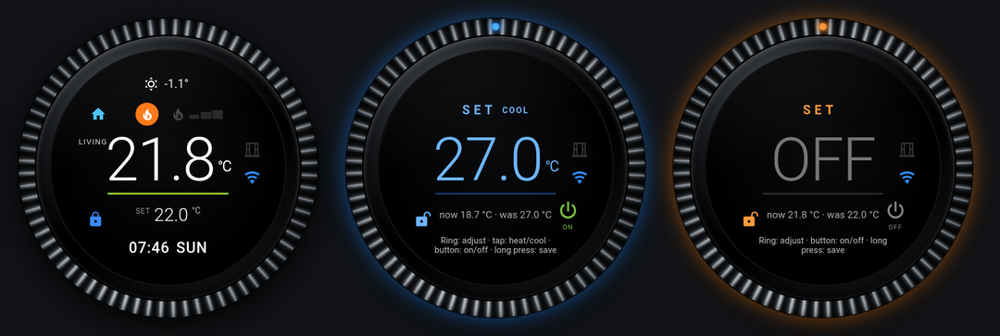

# HC Dial Card

**English** · [Magyar](README.hu.md)

[](https://hacs.xyz/docs/faq/custom_repositories)
[](https://github.com/Gyuszko55/hc-dial-card/actions/workflows/validate.yml)

A round wall-thermostat card for Home Assistant. It works with **any `climate` entity** – single target or heat/cool range – and can optionally **follow the room your phone is in**, so the card always shows the thermostat of the room you are standing in.



## Features

- **Safe setting.** Long-press the display to enter SET mode, turn the knurled ring (or use the mouse wheel / arrow keys) and long-press again to save. Nothing is sent while you turn; after 15 seconds without touch the card leaves SET mode without saving.
- **Any climate entity.** Single target (`temperature`) or range (`target_temp_low` / `target_temp_high`): in SET mode a short tap switches between the heating and the cooling target. The card reads `supported_features`, so it only offers what the thermostat can do.
- **On / off.** A power button in SET mode; saved with the same long press. Uses `climate.turn_on` / `climate.turn_off` when supported, so the thermostat returns to its own previous mode.
- **Status at a glance.** Room temperature, target, weather, outdoor temperature, humidity, HVAC mode, current action (heating, cooling, preheating, defrosting, drying, fan), preset icon (eco = leaf, sleep = bed …), open window, availability.
- **Room following (optional).** With a room-presence sensor (Bermuda, ESPresense, Wi-Fi BSSID …) the card switches to the thermostat of the room you are in. Several thermostats in one room (e.g. a TRV and an air conditioner): the one that is switched on wins.
- **Per-device choice.** Long-press the outer ring to choose which beacon *this* device follows (or none). Stored in the browser of that device.
- **°C / °F** from your Home Assistant settings, number format from your locale. Texts in English, Hungarian and German.
- **Visual editor**, keyboard control and screen-reader labels.

## Installation

### HACS (custom repository)

1. HACS → ⋮ → *Custom repositories* → add `https://github.com/Gyuszko55/hc-dial-card`, type **Dashboard**.
2. Install **HC Dial Card** and reload the browser.

### Manual

Copy `hc-dial-card.js` to `config/www/` and add it as a dashboard resource:

```yaml
url: /local/hc-dial-card.js
type: module
```

## Usage

### Simplest

```yaml
type: custom:hc-dial-card
entity: climate.living_room
```

### With extras

```yaml
type: custom:hc-dial-card
entity: climate.living_room
label: area            # the thermostat's area name (max 6 characters); or any text, e.g. "Living"
weather: weather.home
outdoor: sensor.outdoor_temperature
humidity: sensor.living_room_humidity
heating: binary_sensor.boiler_burning   # optional: real burner state for the flame
window: [binary_sensor.living_window]
```

### Room following with Bermuda

```yaml
type: custom:hc-dial-card
entity: climate.house                    # main thermostat: shown in every other room and when away
label: area
follow_app_only: true                    # follow only inside the Companion app
follow:
  Anna: sensor.anna_phone_area           # HA user name (or user id) → room sensor
  Peter: sensor.peter_phone_area
rooms:
  Terrace: climate.terrace_ac
  Bedroom:                               # several thermostats: the one that is on is shown
    - entity: climate.bedroom_trv
      trv: true                          # a TRV counts as "on" when the main thermostat is on
    - climate.bedroom_ac
```

### ESPresense or Wi-Fi

Map any value to a room with `room_map`:

```yaml
follow: sensor.anna_phone_espresense     # state: living_room
room_map:
  living_room: Living Room
  "aa:bb:cc:dd:ee:ff": Terrace           # Wi-Fi BSSID from the Companion app
rooms:
  Terrace: climate.terrace_ac
```

Room names are matched case- and accent-insensitively against the Home Assistant area name or area id.

## Visual editor

Add the card from the dashboard editor (**Add card → HC Dial Card**) or open an existing one with **Edit**. The editor writes the same YAML as above, so you can switch to the code editor at any time.

| Field | What to enter |
|---|---|
| Thermostat | the climate entity shown by default (required) |
| Label | up to 6 characters before the temperature; `area` = the thermostat's area, `auto` = the room you are in, empty = no label |
| Step | target step; leave empty to use the entity's own step |
| Weather / Outdoor sensor / Humidity sensor | the small top line |
| Actual heating sensor | a binary sensor that is `on` while the burner or compressor really runs (flame / snowflake icon) |
| Window/door sensors | one or more binary sensors; an open one shows the window icon |
| Tap action | `auto`, `more-info`, `cycle` or `none` |
| SET timeout / Switch back | seconds before SET mode closes without saving / before a manually chosen thermostat returns to the room's one |

**Room following (optional)** is a collapsed section at the bottom:

| Field | What to enter |
|---|---|
| Follow | one room sensor (`sensor.phone_area`) or a map `{user name or id: sensor}` – YAML |
| Follow only in the mobile app | on = wall tablets and desktop browsers keep the default thermostat |
| Room → thermostat | `{room: climate entity}`; rooms not listed use the default thermostat – YAML |
| Value → room mapping | only if the sensor's values differ from your room names, e.g. `{kitchen_beacon: Kitchen}` – YAML |
| Area abbreviations | 6-character labels for long area names, e.g. `{Living Room: LIVING}` – YAML |
| Extra beacons for the device menu | sensors offered in the ring's long-press menu besides the Bermuda ones found automatically |
| Away hold | seconds without a room before the main thermostat is shown |
| HC decision sensor | only with the HC Thermostat integration |

Turning room following on in three steps:

1. In **Follow** enter each user's room sensor, e.g. `{Anna: sensor.anna_phone_area}`.
2. In **Room → thermostat** list the rooms that have their own thermostat, e.g. `{Terrace: climate.terrace_ac}`.
3. Optionally switch on **Follow only in the mobile app** and set **Label** to `area`.

Fields marked YAML are small objects: type them as `{key: value}` or as one `key: value` per line. Options not in the editor (`step_angle`, `away_states`) can be added in the code editor.

## Gestures

| Where | Gesture | Action |
|---|---|---|
| Display | long press | enter SET / save |
| Display | short tap | next thermostat (several) or more-info (one) – see `tap_action` |
| Ring (SET) | drag around | change the target |
| Display (SET, range) | short tap | switch heating / cooling target |
| Power button (SET) | tap | on / off |
| Ring (view) | long press | device menu: which beacon this device follows |

Keyboard: Enter = SET / save, Esc = cancel, arrows = step, Space = heating/cooling target, P = on/off, M = device menu.

## Options

| Option | Default | Description |
|---|---|---|
| `entity` | – | climate entity (required) |
| `label` | – | text before the temperature (max 6 chars); `area` = thermostat's area; `auto` = the room you are in |
| `step` | entity step, else 0.5 (°F: 1) | target step |
| `weather`, `outdoor`, `humidity` | – | top line; humidity falls back to the entity's `current_humidity` |
| `heating` | – | binary sensor for the real burner/compressor state |
| `window` | entity `window_open`/`door_open` | binary sensor(s) for open windows |
| `decision` | – | HC Thermostat decision sensor (demand bars, window) |
| `tap_action` | `auto` | `auto`, `more-info`, `cycle`, `none` |
| `timeout` | 15 | seconds before SET mode closes without saving |
| `step_angle` | 18 | ring degrees per step |
| `follow` | – | room sensor, or `{user name or id: sensor}` |
| `follow_app_only` | false | follow only inside the Companion app |
| `follow_choices` | – | extra sensors for the device menu (Bermuda area sensors are found automatically) |
| `rooms` | – | `{room: entity}` or `{room: {entity, label, step, heating, humidity, window}}` or a list |
| `room_map` | – | `{sensor value: room}` |
| `area_labels` | – | short labels, e.g. `{Living Room: LIVING}` |
| `away_states` | `unknown, unavailable, not_home, away, none` | values meaning "no room" |
| `away_hold` | 60 | seconds without a room before the main thermostat is shown |
| `switch_back` | 10 | seconds before a manually chosen thermostat returns to the room's one |

## Part of HC Thermostat

The card was built for the HC Thermostat integration (heating supervision with shadow mode), but it does not need it.

## License

MIT
